# AzkarApp - تطبيق الأذكار ومواقيت الصلاة

تطبيق أندرويد مفتوح المصدر لإدارة الأذكار اليومية ومتابعة مواقيت الصلاة والقبلة بتصميم عصري وأنيق يدعم الوضعين الداكن والفتح، مع خيارات تخصيص متقدمة للخطوط والـ Widgets.

[📥 تحميل تطبيق AzkarApp (ملف APK)](https://github.com/OmarMhran/AzkarApp/releases)
---

## 📱 الشاشات / Screenshots

### Dark & Light Mode

| الشاشة الرئيسية (Home) | أوقات الصلاة (Prayer Times) | المسبحة (Misbaha) |
| :---: | :---: | :---: |
| 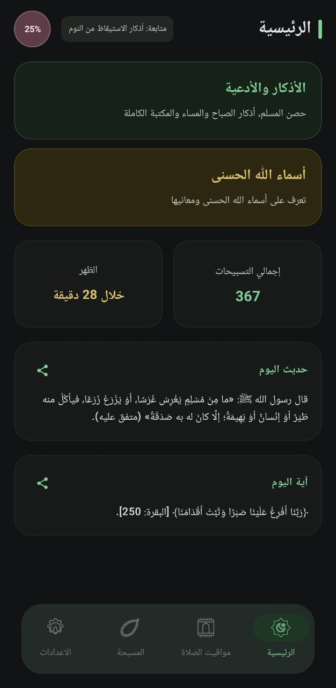   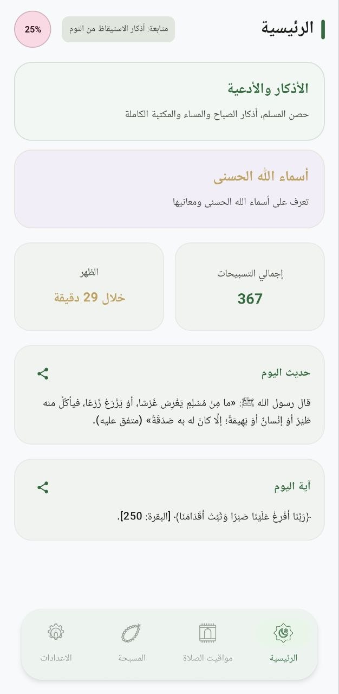 | 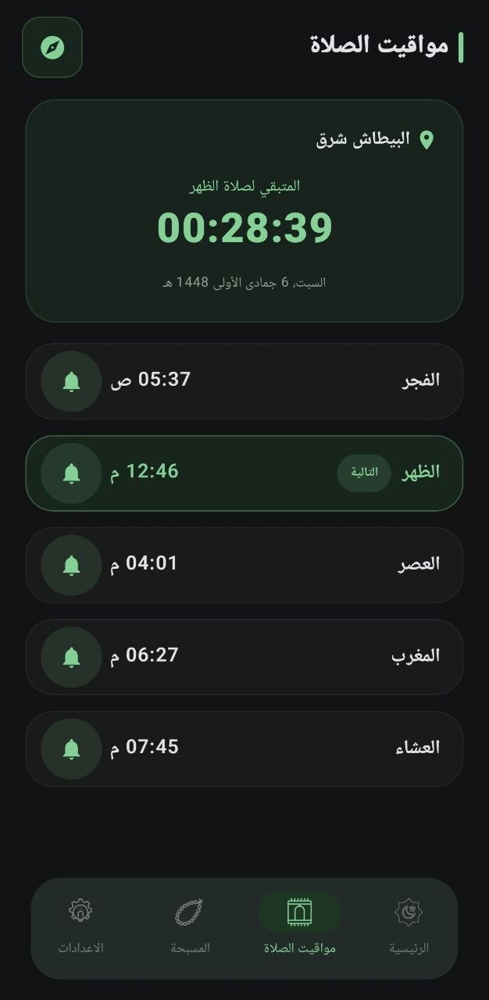   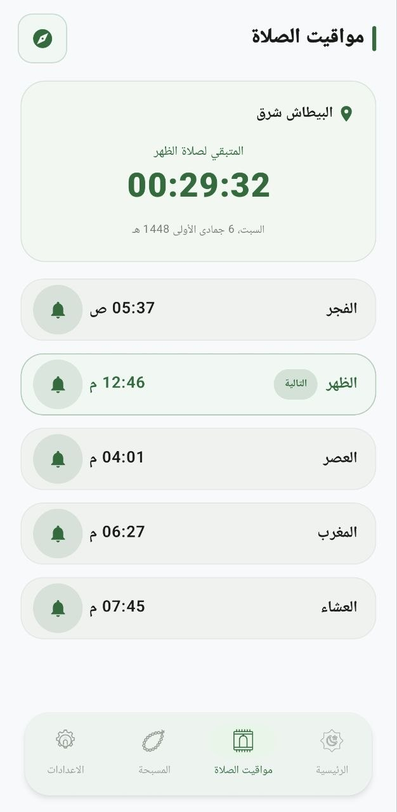 | 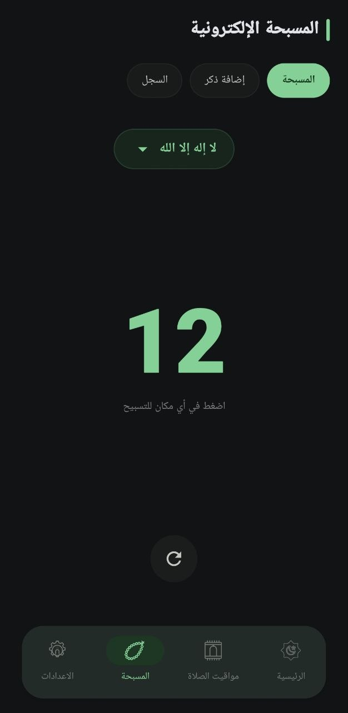   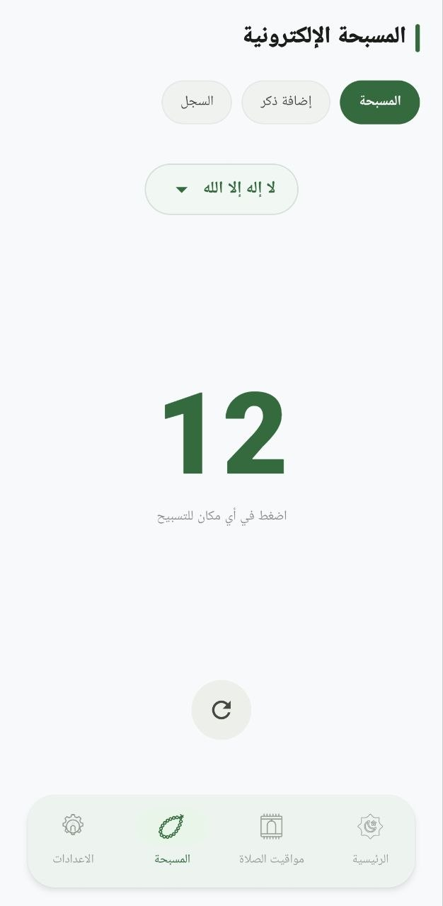 |

| القبلة (Qibla) | الأذكار (Supplications) | الإعدادات (Settings) |
| :---: | :---: | :---: |
| 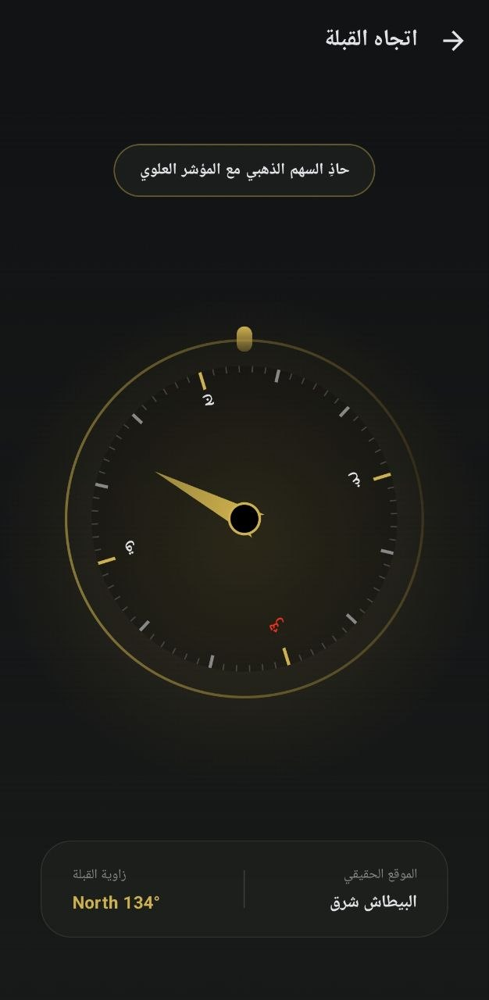   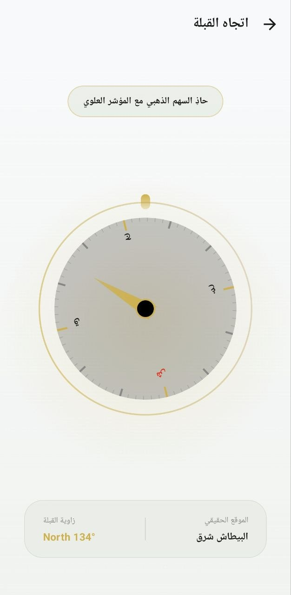 | 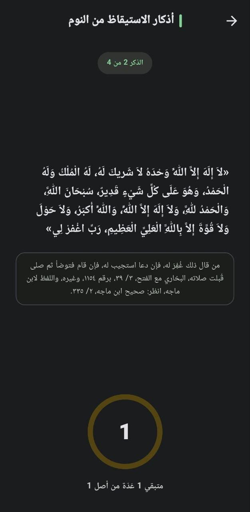   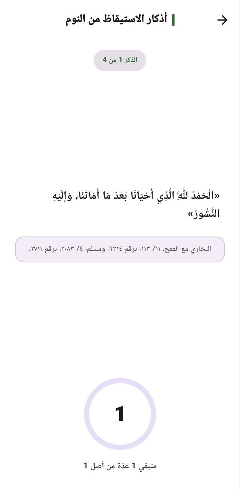 | 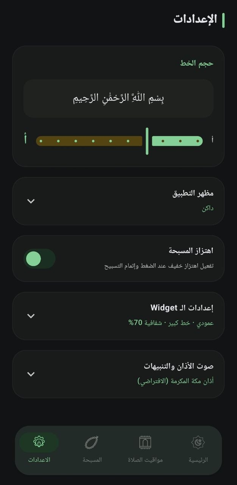   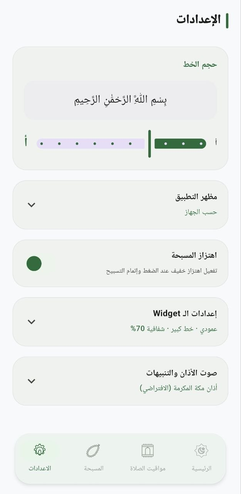 |

---

## ⚡ الميزات الأساسية / Main Features

* **مواقيت الصلاة والقبلة (Prayer Times & Qibla):** حساب مواقيت الصلاة بناءً على الموقع الجغرافي مع بوصلة لتحديد اتجاه القبلة.
* **المسبحة الإلكترونية (Electronic Misbaha):** عداد تسبيح مع حفظ السجل والاهتزاز التفاعلي عند الضغط.
* **الأذكار والأدعية (Azkar & Supplications):** تقسيم حسب الفئات لسهولة الوصول لقراءة أذكار الصباح والمساء وغيرها.
* **إشعارات الذكر (Zikr Notifications):** إشعار مستمر يعرض أذكاراً بفاصل زمني قابل للتخصيص.
* **ويدجت الشاشة الرئيسية (Home Screen Widgets):** أشكال متعددة للـ Widget لمتابعة مواقيت الصلاة والتواريخ الهجرية والميلادية.
* **الوضع الداكن والفاتح (Dark / Light Theme):** دعم كامل للتبديل السلس بين الثيمين.

---

## 🛠️ التقنيات والمكتبات / Tech Stack

* **Language:** Kotlin
* **UI:** Jetpack Compose & Material 3
* **Database:** Room
* **Dependency Injection:** Hilt
* **Async & Streams:** Coroutines & Flow
* **Architecture:** MVVM / Clean Architecture

